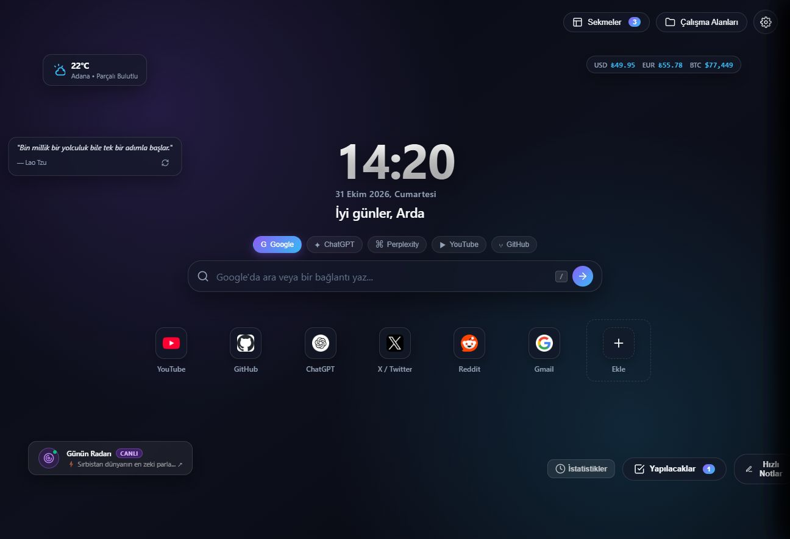

<div align="center">

# 🌌 Nova Tab

### Modern Akıllı Sekme & Çalışma Alanı

**Chrome için yeni nesil Yeni Sekme sayfası** — Canlı video arka planlar, sürükle-bırak düzen, çalışma alanları, Google senkronizasyonu, finans takibi ve daha fazlası.

`Manifest V3` · `Google Sync` · `Sıfır Bağımlılık` · `v5.0.0`



</div>

---

## ✨ Özellikler

### 🎨 Arka Plan & Görünüm
- **Canlı video temalar** — Lo-Fi, yağmur ve siberpunk videoları döngüsel olarak oynatılır
- **İnteraktif tuval** — İmlecinize tepki veren sıvı/parçacık canvas katmanı
- **Dinamik gradientler & glassmorphism** — Birden fazla tema paleti, cam efekti ve köşe yumuşatma ayarı
- **Duvar kağıdı** — Kendi görselinizi yükleyin veya Pinterest bağlantısı kullanın; bulanıklık, yakınlaştırma, döndürme ve kaydırma gibi ince ayarları yapın

### 📊 Canlı Widget'lar
| Widget | Açıklama |
|---|---|
| 🌦️ **Hava Durumu** | Open-Meteo ile otomatik konum veya seçilen şehir |
| 💱 **Finans Ticker** | USD/TRY, EUR/TRY, BTC ve ETH — her 15 dakikada yenilenir |
| 🧭 **Günün Radarı** | Hacker News, GitHub Trending, Vikipedi "Tarihte Bugün" ve NASA APOD — otomatik Türkçe çeviri ile |
| 💬 **Günlük Söz** | Quotable API'den ilham verici sözler |

### 🗂️ Üretkenlik
- **📋 Sekme Yöneticisi** — Tüm açık sekmeleri tek panelden görüntüleyin ve arayın
- **🗄️ Çalışma Alanları** — Projelere göre gruplandırılmış kısayol ve widget kümeleri
- **✅ Yapılacaklar & 📝 Notlar** — Dahili hızlı not defteri ve görev listesi
- **🚀 Sürükle-Bırak Kısayollar** — En sevdiğiniz siteler tek dokunuş uzağınızda

### 🔧 Ayarlar & Senkronizasyon
- **Google Senkronizasyonu** — Ayarlar, notlar, görevler ve çalışma alanları `chrome.storage.sync` ile tüm cihazlarda eşitlenir (kota aşımında otomatik local yedekleme)
- **9-Bölgeli Serbest Düzen** — Widget'ları sürükleyip istediğiniz bölgeye yerleştirin; düzeniniz kaydedilir
- **Çoklu Arama Motoru** — Google, ChatGPT, Perplexity, YouTube ve GitHub arasında tek tuşla geçiş
- **Hoş Geldiniz Turu** — İlk açılışta interaktif tanıtım

---

## 🛠️ Kurulum

### Chrome'dan yükleme (paketlenmemiş)

1. Bu deponun içeriğini indirin veya klonlayın:
   ```bash
   git clone https://github.com/kullanici/novatab.git
   ```
2. Chrome'da → **chrome://extensions** adresine gidin
3. Sağ üstten **Geliştirici modu**'nu açın
4. **Paketlenmemiş yükle** butonuna tıklayıp **`NovaTab/`** klasörünü seçin
5. Yeni bir sekme açın — Nova Tab sizi karşılıyor! 🎉

> **Not:** Eklenti Yeni Sekme sayfasının üzerine yazar. Herhangi bir sunucu yoktur — tüm veriler tarayıcınızda (sync/local storage) tutulur.

---

## 🌐 Kullanılan API'ler

Nova Tab yalnızca ücretsiz ve API anahtarı gerektirmeyen açık servisleri kullanır:

| Servis | Kullanım |
|---|---|
| [Open-Meteo](https://open-meteo.com) | Hava durumu & geokodlama |
| [Open Exchange Rates (open.er-api.com)](https://open.er-api.com) | Döviz kurları |
| [Binance API](https://api.binance.com) | BTC / ETH kurları |
| [Quotable](https://api.quotable.io) | Günlük sözler |
| [Hacker News](https://hacker-news.firebaseio.com) | Günün radarı |
| [GitHub API](https://api.github.com) | Trend repository'ler |
| [TR Wikipedia](https://tr.wikipedia.org) | Tarihte bugün |
| [NASA APOD](https://api.nasa.gov) | Günün astronomi fotoğrafı |
| [Mixkit](https://assets.mixkit.co) | Canlı video temalar |

---

## 📁 Proje Yapısı

```
NovaTab/
├── manifest.json          # Chrome Manifest V3 konfigürasyonu
├── newtab.html            # Ana sayfa arayüzü
├── css/
│   └── style.css          # Tüm stiller (glassmorphism, temalar)
├── icons/                 # Eklenti ikonları (16/48/128)
└── js/
    ├── app.js             # Ana orkestratör: temalar, ayarlar, senkron
    ├── layout.js          # 9-bölgeli sürükle-bırak yerleşim motoru
    ├── workspaces.js      # Çalışma alanı yönetimi
    ├── tabs-manager.js    # Sekme yöneticisi
    ├── shortcuts.js       # Hızlı erişim kısayolları
    ├── search.js          # Çoklu arama motoru
    ├── weather.js         # Hava durumu modülü
    ├── finance.js         # Döviz & kripto ticker
    ├── radar.js           # Günün radarı (canlı içerik akışı)
    ├── quotes.js          # Günlük sözler
    ├── todo.js            # Görev listesi
    ├── notes.js           # Notlar
    ├── analytics.js       # Kullanım istatistikleri
    ├── interactive-bg.js  # İnteraktif parçacık canvas'ı
    ├── tutorial.js        # İlk açılış turu
    ├── sync-storage.js    # Google sync + local yedekleme katmanı
    └── utils.js           # Ortak yardımcılar
```

---

## 🔐 İzinler

| İzin | Amaç |
|---|---|
| `storage` | Ayarları, notları ve çalışma alanlarını kaydetmek |
| `tabs` | Sekme yöneticisinin açık sekmeleri listelemesi |
| Host izinleri | Yukarıda listelenen ücretsiz API'lere bağlanmak |

Kod herkese açıktır — hiçbir telemetri veya veri toplama yapılmaz.

---

<div align="center">

**Nova Tab** ile made with 💜 —
İyi sekmeler! 🚀

</div>
